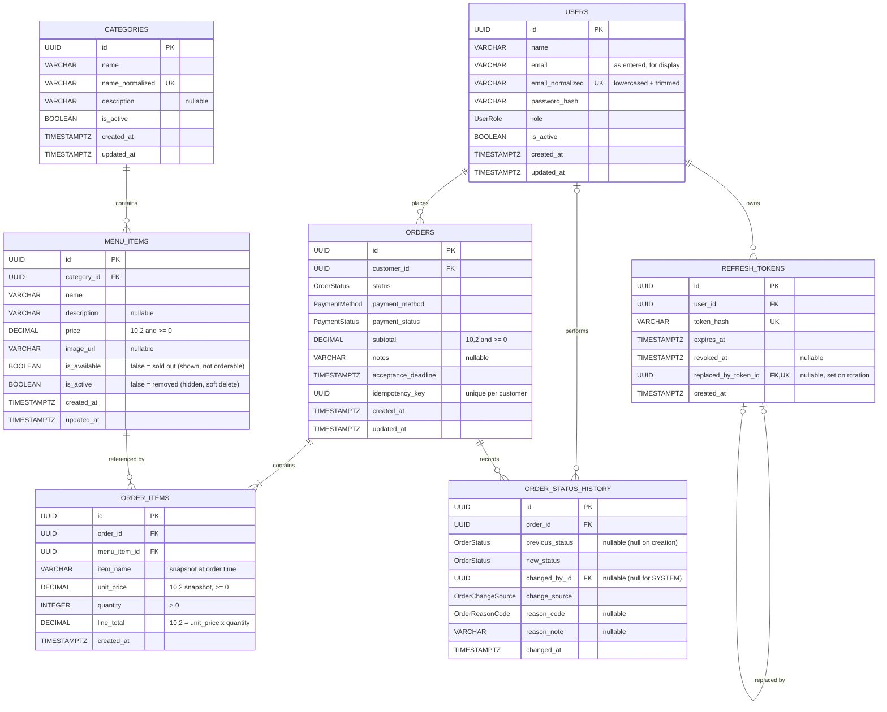

# FoodFlow – Database Design

PostgreSQL schema for the FoodFlow MVP (single restaurant, pickup only, pay on collection).
Managed with Prisma; all schema changes go through Prisma migrations.

## 1. Entity Relationship Diagram



## 2. Enums

| Enum                | Values                                                                                                      |
| ------------------- | ----------------------------------------------------------------------------------------------------------- |
| `UserRole`          | `CUSTOMER`, `STAFF`, `ADMIN`                                                                                |
| `OrderStatus`       | `PENDING`, `ACCEPTED`, `REJECTED`, `PREPARING`, `READY`, `COMPLETED`, `CANCELLED`                           |
| `PaymentMethod`     | `PAY_ON_COLLECTION` (future: `CARD`)                                                                        |
| `PaymentStatus`     | `UNPAID`, `PAID` (future: `REFUNDED`)                                                                       |
| `OrderChangeSource` | `CUSTOMER`, `STAFF`, `SYSTEM`                                                                               |
| `OrderReasonCode`   | `CUSTOMER_REQUEST`, `ITEM_UNAVAILABLE`, `KITCHEN_BUSY`, `RESTAURANT_CLOSING`, `ACCEPTANCE_TIMEOUT`, `OTHER` |

## 3. Constraints

**Primary and unique keys**

- Every table uses a UUID primary key.
- `users.email_normalized` is unique (prevents `A@x.com` and `a@x.com` both registering).
- `categories.name_normalized` is unique.
- `refresh_tokens.token_hash` and `refresh_tokens.replaced_by_token_id` are unique.
- `orders (customer_id, idempotency_key)` is a composite unique constraint.

**Foreign keys** (all `ON DELETE RESTRICT`; nothing that orders depend on is ever hard-deleted)

- `refresh_tokens.user_id → users.id`
- `refresh_tokens.replaced_by_token_id → refresh_tokens.id`
- `menu_items.category_id → categories.id`
- `orders.customer_id → users.id`
- `order_items.order_id → orders.id`
- `order_items.menu_item_id → menu_items.id`
- `order_status_history.order_id → orders.id`
- `order_status_history.changed_by_id → users.id`

**CHECK constraints**

- `menu_items.price >= 0`
- `orders.subtotal >= 0`
- `order_items.unit_price >= 0`
- `order_items.quantity > 0`
- `order_items.line_total = unit_price * quantity`
- `order_status_history`: `changed_by_id IS NULL` only when `change_source = 'SYSTEM'`

> Prisma does not express CHECK constraints in the schema file. Add them as raw SQL in the migration.

## 4. Indexes

PostgreSQL does not index foreign key columns automatically, so these are added explicitly.

| Index                                                   | Supports                                                          |
| ------------------------------------------------------- | ----------------------------------------------------------------- |
| `orders (customer_id, created_at DESC)`                 | Customer order history, newest first (US-07)                      |
| `orders (status, created_at)`                           | Staff order queue and admin status filter (US-10, US-16)          |
| `orders (acceptance_deadline) WHERE status = 'PENDING'` | Recovery sweep for overdue orders if a BullMQ job is lost (US-17) |
| `order_items (order_id)`                                | Loading the items of an order                                     |
| `order_items (menu_item_id)`                            | FK lookups; checking whether an item appears in orders            |
| `order_status_history (order_id, changed_at)`           | Status timeline of an order; latest rejection/cancellation reason |
| `menu_items (category_id)`                              | Category filter on the menu (US-04)                               |
| `refresh_tokens (user_id)`                              | Revoking all of a user's tokens (logout everywhere, deactivation) |

Unique constraints already create indexes for: `users.email_normalized`, `categories.name_normalized`, `refresh_tokens.token_hash`, `orders (customer_id, idempotency_key)`.

Menu name search uses `ILIKE` for the MVP. If it becomes slow, add a `pg_trgm` GIN index on `menu_items.name`.

## 5. Design Decisions

**One `users` table with a `role` column.**
All roles share the same login data and behaviour. Separate tables would duplicate authentication logic for no benefit. Role checks happen in middleware.

**Price and name snapshots in `order_items`.**
`unit_price` and `item_name` are copied when the order is placed. If staff later change a menu item's price or name, past orders still show what the customer actually paid for.

**Money stored as `DECIMAL(10,2)`, never `FLOAT`.**
Floating-point numbers cannot represent values like 0.1 exactly, so totals drift by tiny amounts. DECIMAL is exact.

**Soft delete for menu items and categories.**
Items referenced by past orders cannot be deleted (FK `RESTRICT`).

- `is_active = false`: removed from the menu and hidden from customers.
- `is_available = false`: sold out today; shown to customers but cannot be ordered.

**Status history table.**
`orders.status` holds the current state for fast queries. `order_status_history` records every transition: when it happened, who made it (or `SYSTEM`), and why. Rejection and cancellation reasons live here; the customer sees the reason from the latest history row.

**Idempotency key per customer.**
The frontend generates a UUID when checkout starts and sends it with the order. If the same request arrives twice (double click, network retry), the unique constraint on `(customer_id, idempotency_key)` blocks the duplicate, and the API returns the existing order instead.

**Refresh tokens stored as hashes, with rotation.**
Access tokens are short-lived JWTs and are not stored. Refresh tokens are stored hashed so they can be revoked (logout, account deactivation). Each refresh issues a new token and sets `replaced_by_token_id` on the old one. If an already-replaced token is used again, it was likely stolen, so all of that user's tokens are revoked.

**Acceptance deadline.**
`acceptance_deadline = created_at + 15 minutes`. A BullMQ delayed job auto-cancels the order if it is still `PENDING`. The stored deadline lets a periodic sweep catch any orders whose job was lost.

## 6. Business Rules Enforced in Code

**Status changes are conditional updates (race-condition protection).**
Staff accepting an order and the auto-cancel job can run at the same moment. Every transition updates only if the order is still in the expected state:

```sql
UPDATE orders
SET status = 'ACCEPTED', updated_at = now()
WHERE id = $1 AND status = 'PENDING';
```

If 0 rows are updated, another actor changed the order first, and the API returns `409 Conflict`. The status update and its history row are written in the same transaction.

**Allowed transitions**

| From        | To                     | Actor                         |
| ----------- | ---------------------- | ----------------------------- |
| —           | `PENDING`              | Customer (order placed)       |
| `PENDING`   | `ACCEPTED`, `REJECTED` | Staff                         |
| `PENDING`   | `CANCELLED`            | Customer, or System (timeout) |
| `ACCEPTED`  | `PREPARING`            | Staff                         |
| `PREPARING` | `READY`                | Staff                         |
| `READY`     | `COMPLETED`            | Staff                         |

Any other transition is rejected.

**Order creation is a single transaction:** insert the order, its items and the first history row (`null → PENDING`) together, or none of them.

**Totals are calculated by the server** from current database prices; prices sent by the client are ignored.

**Payment status:** orders start as `UNPAID`. For `PAY_ON_COLLECTION`, `payment_status` becomes `PAID` in the same transaction that moves the order to `COMPLETED`.
